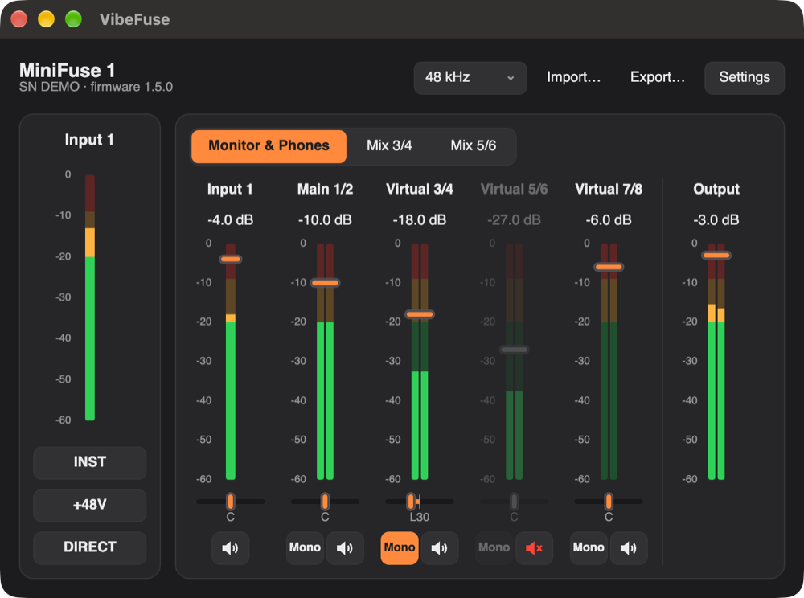

# VibeFuse

A control panel for the Arturia MiniFuse 1 audio interface on macOS, Windows and Linux.

[Русская версия](README.ru.md)



- Input settings (INST, +48V, Direct monitor), level meters and the sample rate.
- A mixer with three mixes: Monitor & Phones, Mix 3/4 and Mix 5/6. On Windows it uses
  Arturia's driver; on macOS and Linux VibeFuse adds virtual devices for it.
- Settings are restored every time the interface is connected.
- Presets compatible with MiniFuse Control Center.
- Runs in the menu bar or tray. English and Russian.

## Install

Download the latest version from the Releases page.

- **macOS 11 or later.** Open the `.dmg` and drag VibeFuse to Applications. The app is not
  notarized, so open it the first time with right-click → Open.
- **Windows 10 or 11.** Install Arturia's MiniFuse Audio Driver first (it comes with
  MiniFuse Control Center). Put the `.exe` in a folder where it will stay and run it. The
  program is not signed, so Windows asks the first time: More info → Run anyway.
- **Linux.** Unpack the archive and run `./install.sh`. It installs VibeFuse for your user
  and adds a udev rule, so it asks for `sudo` once. `./install.sh --remove` uninstalls.

## Virtual outputs (macOS, Linux)

Install them in Settings → Virtual outputs. Apps then see these devices:

| Device | Use |
|---|---|
| VibeFuse Main 1/2 | main playback |
| VibeFuse Virtual 3/4, 5/6, 7/8 | playback for separate apps |
| VibeFuse Mix 3/4, Mix 5/6 | record a mix in streaming or call apps |
| VibeFuse Loopback Main 7/8 | a copy of Monitor & Phones |

On macOS this needs the administrator password and access to the microphone, through which
the interface's input reaches the mixes. On Linux it needs PipeWire 1.0 or later.

## Build

```sh
cargo run --release
cargo test
```

Linux needs `libfontconfig1-dev libfreetype-dev libxkbcommon-dev`; macOS needs the Xcode
Command Line Tools. `sh scripts/package.sh` builds the release package for your system.

To publish a release, run the Release workflow in GitHub Actions and pick which part of
the version to raise, or `none` to release the current one. It commits the new version,
tags it, and attaches the macOS, Windows and Linux packages to a new release.

## Privacy

VibeFuse collects nothing. While its window is open it checks
[Arturia's MiniFuse page](https://www.arturia.com/products/audio/minifuse/resources) once a
day for new firmware.

## License

GPL-3.0-or-later, see [LICENSE](LICENSE). The licenses of the components VibeFuse is
built from are in THIRD-PARTY-NOTICES.txt, inside the macOS and Linux packages and on
each release page.

VibeFuse is not affiliated with Arturia. Arturia and MiniFuse are trademarks of Arturia.
