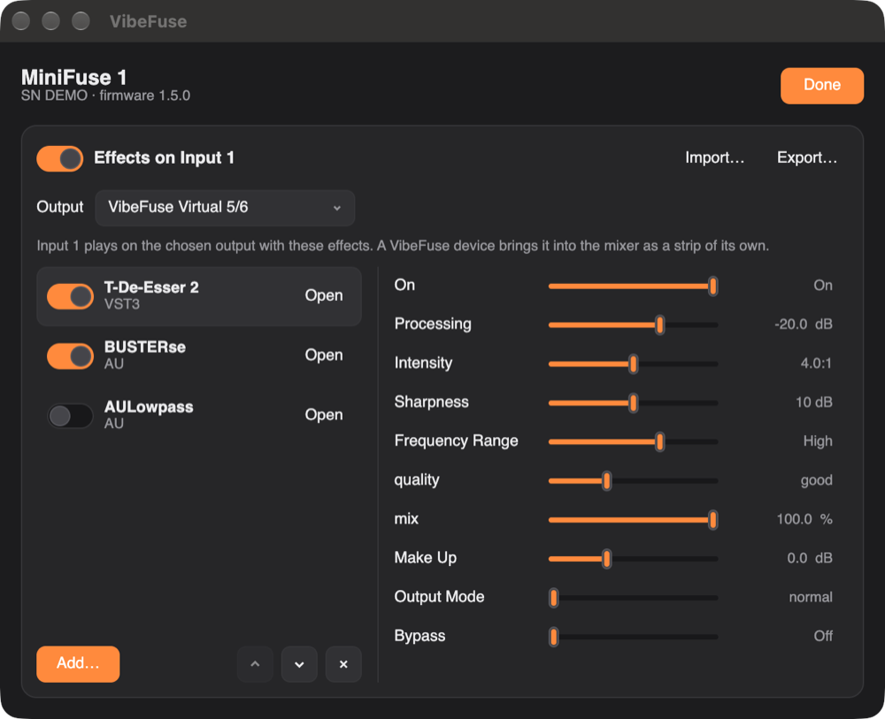

# VibeFuse

Панель управления звуковой картой Arturia MiniFuse 1 для macOS и Windows.

[English](README.md)

- Настройки входа (INST, +48V, Direct monitor), индикаторы уровня и частота дискретизации.
- Микшер на три микса: Monitor & Phones, Mix 3/4 и Mix 5/6. На Windows он работает через
  драйвер Arturia, на macOS VibeFuse добавляет для него виртуальные устройства.
- Эффекты на микрофон: плагины VST3, VST2, Audio Unit (macOS) и LADSPA.
- Настройки возвращаются при каждом подключении карты.
- Пресеты, совместимые с MiniFuse Control Center.
- Работает из строки меню или трея. Русский и английский язык.

## Установка

Скачайте последнюю версию на странице Releases.

- **macOS 11 и новее.** Откройте `.dmg` и перетащите VibeFuse в «Программы». Программа не
  заверена Apple, поэтому в первый раз откройте её через правый щелчок → «Открыть».
- **Windows 10 или 11.** Сначала установите драйвер Arturia MiniFuse Audio Driver (он идёт
  вместе с MiniFuse Control Center). Положите `.exe` в папку, где он будет лежать, и
  запустите. Программа не подписана, поэтому в первый раз Windows спросит: «Подробнее» →
  «Выполнить в любом случае».

## Виртуальные выходы (macOS)

Устанавливаются в «Настройки → Виртуальные выходы». После этого программы видят устройства:

| Устройство | Для чего |
|---|---|
| VibeFuse Main 1/2 | основной звук |
| VibeFuse Virtual 3/4, 5/6, 7/8 | звук отдельных программ |
| VibeFuse Mix 3/4, Mix 5/6 | запись микса в программах для стримов и звонков |
| VibeFuse Loopback Main 7/8 | копия Monitor & Phones |

Для этого нужен пароль администратора и доступ к микрофону: через него вход карты попадает
в миксы.

Чтобы слышать себя в наушниках, включите Input 1 в миксе Monitor & Phones или нажмите DIRECT,
чтобы карта сама выводила вход без задержки. Пока Input 1 звучит в этом миксе, система
показывает, что микрофон используется.

## Эффекты на микрофон



Нажмите FX у входа, затем «Добавить…». VibeFuse пропускает Вход 1 через плагины VST3, VST2,
Audio Unit (macOS) и LADSPA сверху вниз и выводит результат на выход, который вы выберете.
Переключатель рядом с плагином временно его отключает, «Открыть» показывает его собственное
окно. Настройки плагина есть и на странице, с ползунками; щёлкните по значению, чтобы ввести
его, например `-6 dB` или `50%`. Плагины ищутся в обычных папках, «Папка…» добавляет ещё
одну. Цепочку можно экспортировать в файл и импортировать на другом компьютере: плагины,
которых там нет по прежнему пути, ищутся по имени.

Своего буфера эффекты не добавляют, только задержку, о которой сообщает сам плагин
(например, упреждение лимитера):

- **macOS.** Выход — любое устройство вывода: MiniFuse, чтобы слышать себя, устройство
  VibeFuse (например, Virtual 5/6), чтобы обработанный голос был в микшере отдельной
  полосой, или виртуальный кабель в другую программу. Эффекты работают блоками по 128
  сэмплов (2,7 мс при 48 кГц) по часам MiniFuse, другое устройство подстраивается под них.
- **Windows.** Выход — пара выходов ASIO-драйвера Arturia с размером буфера из настроек.
  Out 3/4 возвращаются в микшер как Virtual 3/4. Пока эффекты включены, другие программы не
  могут пользоваться ASIO: выключите эффекты, чтобы освободить его.

Плагины загружаются в сам VibeFuse, так что неисправный может его уронить. Плагин,
уронивший программу при поиске, пропускается, пока не изменится.

## Сборка

```sh
cargo run --release
cargo test
```

Для macOS нужны Xcode Command Line Tools. Пакет для выпуска под вашу систему собирает
`sh scripts/package.sh`. `cargo test -- --ignored installed` прогоняет через цепочку все
эффекты, установленные на компьютере.

Версии выходят сами: когда CI проходит на `main` и программа изменилась, workflow
«Release» поднимает patch-версию, ставит тег и выкладывает пакеты для macOS и Windows.
Minor, major или выпуск текущей версии (`none`) — вручную в GitHub Actions.

## Приватность

VibeFuse ничего не собирает. Пока открыто окно, раз в сутки он проверяет новую прошивку на
[странице MiniFuse у Arturia](https://www.arturia.com/products/audio/minifuse/resources).

## Лицензия

GPL-3.0 или более поздняя, см. [LICENSE](LICENSE). Лицензии компонентов собраны в
THIRD-PARTY-NOTICES.txt: он лежит в пакетах и на странице каждого релиза.

VibeFuse не связан с Arturia. Arturia и MiniFuse — товарные знаки Arturia. VST — товарный
знак Steinberg Media Technologies GmbH, Audio Units — Apple Inc.
